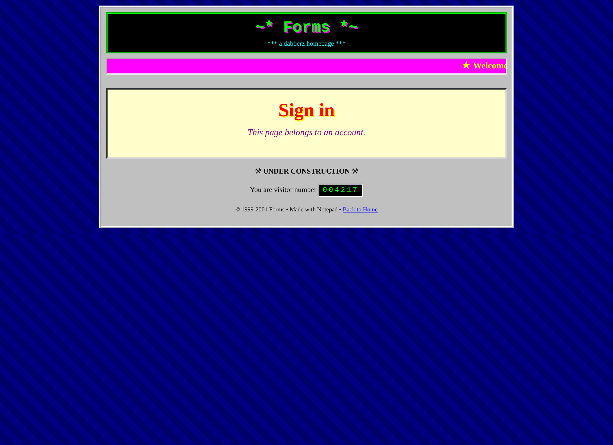
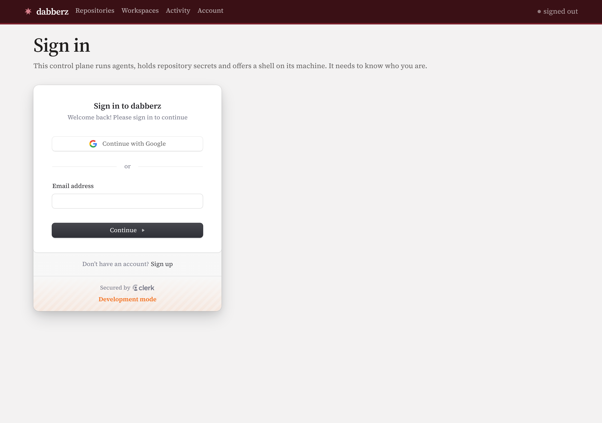

# dabberz

**SaaS-as-a-service: the self-host for people who are not technical.**

You install your own HubSpot or Notion equivalent. dabberz runs it — the
machine, the database, the backups, the uptime — and when you want it changed,
you ask in English. An agent makes the change on a copy, it gets checked, you
decide whether it goes live, and your data stays yours.

The objection this answers is not *can I run my own tools*. It is *do I want to
be the person who runs them*.

---



That is a real installation on the live host, reached over its own public
hostname. Four things are visible in one screenshot:

- **An app the platform installed** — provisioned a Postgres database, seeded a
  git repository, built it, started it, gave it a hostname.
- **A change an agent made, now live.** Somebody asked for a 1999 homepage.
  The agent wrote it on a branch, against a fork of the data, behind a
  throwaway preview. A human promoted it.
- **The sign-in prompt, with an asterisk.** The app does not implement login —
  the platform decides who a visitor is. But this screenshot predates the
  access policy work (public / internal / hybrid), so what it shows is an app
  with no policy yet rather than a policy being enforced. The enforcement is
  real and tested; this picture is not the evidence for it.
- **Actually hosted** — HTTPS through a CDN, health endpoint green, systemd
  underneath.

## Asking for a change

```
POST /v1/installations                    install an app              ~60s
POST /v1/installations/{id}/changes       own branch, machine, data    ~3s
POST /v1/workspaces/{ws}/messages         the agent does the work
POST /v1/changes/{id}/check               its tests + a real browser
POST /v1/changes/{id}/promote             a human, never the agent
POST /v1/installations/{id}/rollback      one request, back to before
```

A change gets its own machine, its own branch, its own preview hostname, and
its own **copy of the real data** — forked a moment earlier, so experimenting
cannot reach anything a customer depends on, and a migration is tested against
records that actually exist.

## Three problems that were harder than they look

**Telling an app who is asking, without letting a visitor decide.** Apps behind
the platform never implement login; the edge tells them. That means stripping
identity headers a visitor sent *and* asserting the real ones — and the obvious
version of the second half is a cross-tenant hole. Every customer has an
account, so announcing any signed-in visitor would make each of them an
administrator of everybody else's installation, with nothing looking broken. A
published route carries whose hostname it is, and only that person is
announced. ([`internal/proxy/hostmux`](internal/proxy/hostmux))

**Making "nothing goes live unchecked" true about a commit.** Checks mean
little if the preview runs a binary built before the agent's last commit — then
the app's own suite tests the new code while the browser looks at the old, and
together they describe something that never existed. So checking rebuilds the
preview on the current revision first, records which one that was, and
promotion refuses a revision that has moved since.
([`internal/install/check.go`](internal/install/check.go))

**Keeping production off the table.** An agent is addressed by workspace, and a
running installation has one — so the whole safety story could be sidestepped
by naming it, after which the agent's edits would either be discarded by the
next deploy or served to customers having been reviewed by nobody. An agent
turn in a serving workspace is refused and told to open a change.

Each of those is covered by a test that was confirmed by deleting the guard and
watching it fail. That is the house style: a test nobody has seen fail is not
evidence.

## How it is built

Go, four direct dependencies, ~50k lines, ~600 tests. SQLite for the control
plane; a Postgres database per installation. The reverse proxy that routes
preview hostnames, the WebSocket framing for workspace shells, and the Chrome
DevTools client that drives the browser checks are all in-tree rather than
pulled in — each was a few hundred lines and removed a dependency from the
path that has to stay up.

Apps declare what they need in a manifest (`dabberz.yaml`); an app that asks
for a block the deployment does not provide is refused at install time with the
missing names, rather than installed and left to fail at runtime.



## Where it runs

One OVH box: Debian 13, ZFS mirror, Postgres on a copy-on-write dataset, the
daemon under systemd, Cloudflare in front. The host is built by one idempotent
script ([`deploy/bootstrap-host.sh`](deploy/bootstrap-host.sh)) rather than by
somebody typing into an SSH session.

**Honest about scope.** This runs one operator's own installations. The
Firecracker driver does not boot guests yet, so agents run on the host rather
than in microVMs — fine for a single owner, and the thing to fix before a
second account exists. It is written down rather than discovered:
[`docs/HANDOFF.md`](docs/HANDOFF.md) lists what is unfinished, unverified, or
known wrong.

## Reading further

- [`docs/PLATFORM.md`](docs/PLATFORM.md) — the contract apps are built against:
  blocks, the manifest, checks and their honest limits, agent access, pricing
  principles.
- [`docs/DIRECTION.md`](docs/DIRECTION.md) — why it is shaped this way, and what
  changed when the project pivoted.
- [`docs/HOST.md`](docs/HOST.md) — what a machine has to provide, and which
  choices cannot be undone after install.
- [`docs/ARCHITECTURE.md`](docs/ARCHITECTURE.md) — the pieces and how they fit.
